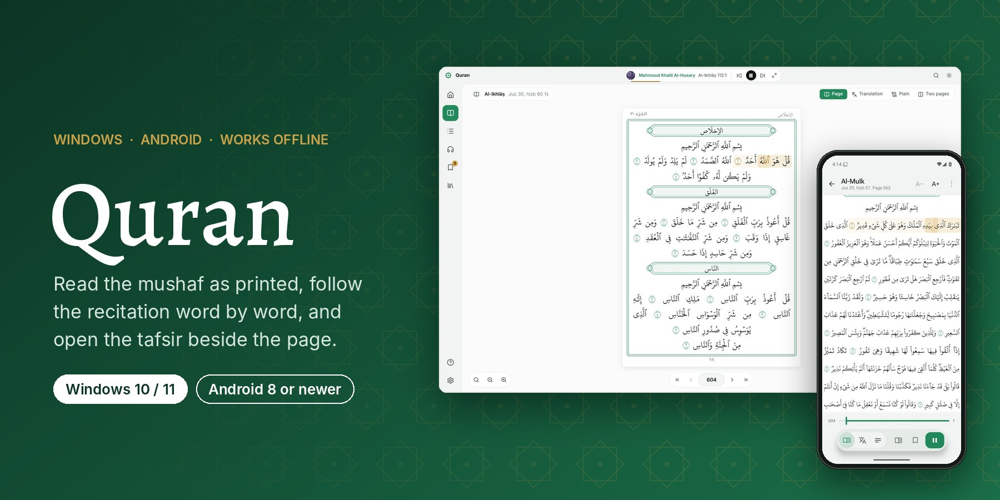
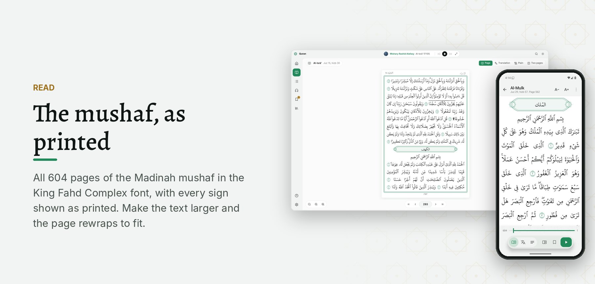
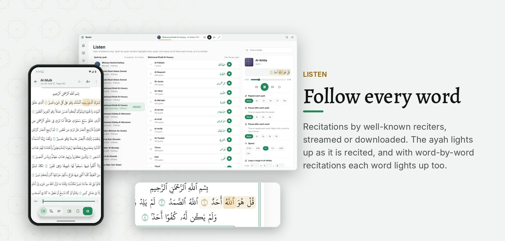
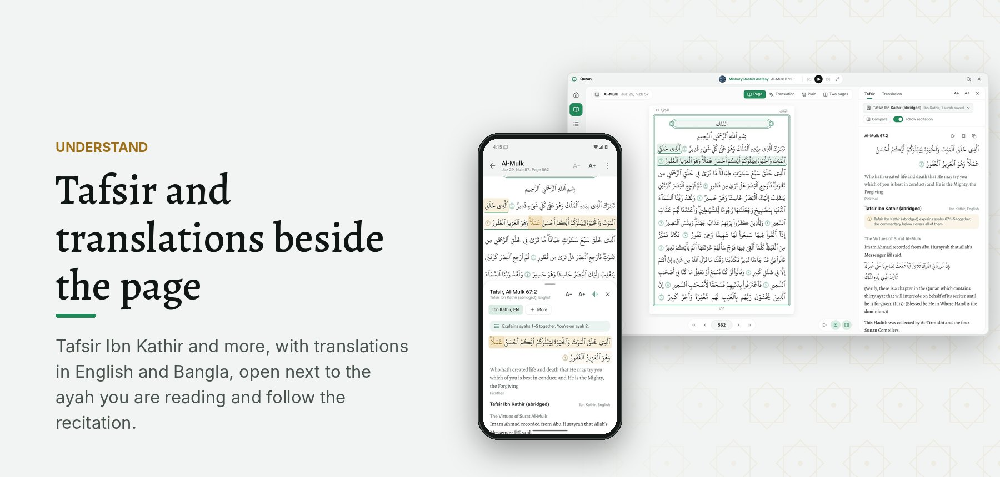
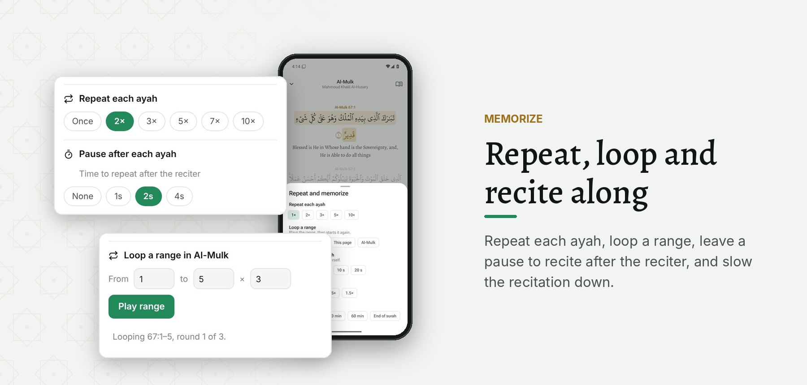
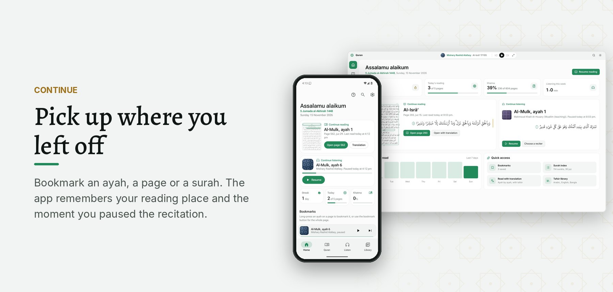
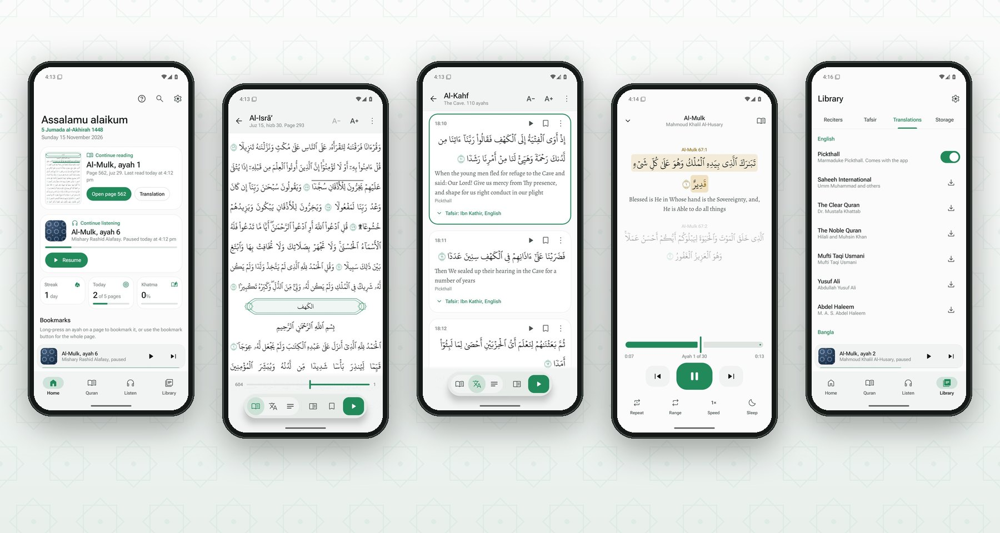

  

<h3 align="center">Read, listen and reflect, on your PC and your phone.</h3>

  
  &nbsp;
  

  Windows 10 and 11 &nbsp;·&nbsp; Android 8.0 or newer &nbsp;·&nbsp; Works offline &nbsp;·&nbsp; Help in English and Bangla

---

## On your phone

## Why you'll like it

- **Text you can trust.** The King Fahd Complex (KFGQPC) edition of Hafs from Asim, in its own font. The apps check the text every time they start and won't open if it has been changed.
- **The page you know.** The Madinah mushaf layout, 604 pages, with every sign shown as printed.
- **Reciters you love.** Choose from well-known reciters, stream or download, and watch each word light up as it is recited.
- **Meaning beside the words.** Tafsir Ibn Kathir and more, and translations in English and Bangla.
- **Built for memorizing.** Repeat, loop a range, pause to recite after the reciter, slow it down.
- **Never lose your place.** Bookmarks for ayahs, pages and surahs; reading and listening resume where you stopped.
- **Yours, on your device.** Everything you download stays on your device.

## Download

Open **[Releases](../../releases)** and choose the newest release for your device. The files are under **Assets**.

| | Your device | File to download |
|---|---|---|
|  | Windows 10 or 11, 64-bit | `Quran_<version>_x64-setup.exe` (recommended, no administrator rights needed) or `Quran_<version>_x64_en-US.msi` (installs for every user, needs administrator rights) |
|  | Android 8.0 or newer | `Quran-<version>.apk` |

<b>Installing on Windows</b>

1. Download the `setup.exe` and open it.
2. The installer is not code-signed yet, so Windows SmartScreen may say **"Windows protected your PC"**. Choose **More info**, then **Run anyway**.
3. WebView2 is downloaded during setup if it is missing (Windows 11 already has it).

To update, install the newer version over the old one. Your bookmarks and settings are kept.

<b>Installing on Android</b>

1. Open the release on your phone and tap the `.apk` file to download it.
2. Open the file. Android asks you to allow your browser (or file manager) to **install unknown apps**: allow it for this install.
3. If Google Play Protect warns that the app is unknown, choose **Install anyway**. The app is not on Google Play yet.

Later versions install over the earlier one and keep your bookmarks, progress and downloads.

<b>Checking a download</b>

Each release has a `SHA256SUMS.txt`. To check a file:

- Windows: `certutil -hashfile Quran_<version>_x64-setup.exe SHA256`
- Linux / macOS: `sha256sum -c SHA256SUMS.txt`

## Questions

**Do I need the internet?** Only to download recitations, tafsir and translations. Once they are on your device, the app works offline.

**Which riwayah?** Hafs from Asim.

**Is there help inside the app?** Yes: a one-minute guided tour and a Help page, in English and Bangla.

**What are the "Source code" files on each release?** GitHub adds them to every release automatically. Here they only contain this page.

**Found a problem or have an idea?** Open an [issue](../../issues) with your device, the app version and what happened.
